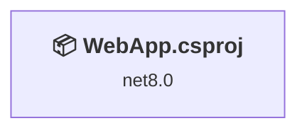
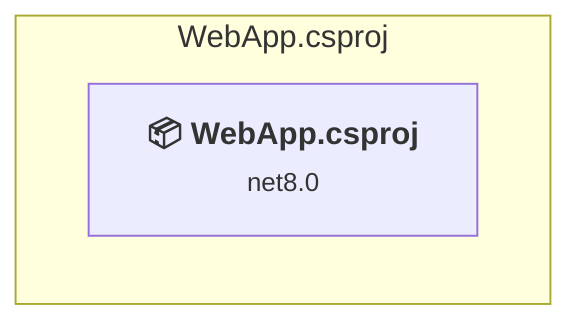

# Projects and dependencies analysis

This document provides a comprehensive overview of the projects and their dependencies in the context of upgrading to .NETCoreApp,Version=v10.0.

## Table of Contents

- [Executive Summary](#executive-Summary)
  - [Highlevel Metrics](#highlevel-metrics)
  - [Projects Compatibility](#projects-compatibility)
  - [Package Compatibility](#package-compatibility)
  - [API Compatibility](#api-compatibility)
  - [Binding Redirect Configuration](#binding-redirect-configuration)
- [Aggregate NuGet packages details](#aggregate-nuget-packages-details)
- [Top API Migration Challenges](#top-api-migration-challenges)
  - [Technologies and Features](#technologies-and-features)
  - [Most Frequent API Issues](#most-frequent-api-issues)
- [Projects Relationship Graph](#projects-relationship-graph)
- [Project Details](#project-details)

  - [WebApplication\WebApp.csproj](#webapplicationwebappcsproj)

## Executive Summary

### Highlevel Metrics

| Metric | Count | Status |
| :--- | :---: | :--- |
| Total Projects | 1 | All require upgrade |
| Total NuGet Packages | 50 | 2 need upgrade |
| Total Code Files | 15 |  |
| Total Code Files with Incidents | 2 |  |
| Total Lines of Code | 826 |  |
| Total Number of Issues | 4 |  |
| Estimated LOC to modify | 1+ | at least 0,1% of codebase |

### Projects Compatibility

| Project | Target Framework | Difficulty | Package Issues | API Issues | Binding Issues | Est. LOC Impact | Description |
| :--- | :---: | :---: | :---: | :---: | :---: | :---: | :--- |
| [WebApplication\WebApp.csproj](#webapplicationwebappcsproj) | net8.0 | 🟢 Low | 2 | 1 | 0 | 1+ | AspNetCore, Sdk Style = True |

### Package Compatibility

| Status | Count | Percentage |
| :--- | :---: | :---: |
| ✅ Compatible | 48 | 96,0% |
| ⚠️ Incompatible | 0 | 0,0% |
| 🔄 Upgrade Recommended | 2 | 4,0% |
| ***Total NuGet Packages*** | ***50*** | ***100%*** |

### API Compatibility

| Category | Count | Impact |
| :--- | :---: | :--- |
| 🔴 Binary Incompatible | 0 | High - Require code changes |
| 🟡 Source Incompatible | 0 | Medium - Needs re-compilation and potential conflicting API error fixing |
| 🔵 Behavioral change | 1 | Low - Behavioral changes that may require testing at runtime |
| ✅ Compatible | 1469 |  |
| ***Total APIs Analyzed*** | ***1470*** |  |

## Aggregate NuGet packages details

| Package | Current Version | Suggested Version | Projects | Description |
| :--- | :---: | :---: | :--- | :--- |
| Humanizer.Core | 2.14.1 |  | [WebApp.csproj](#webapplicationwebappcsproj) | ✅Compatible |
| Microsoft.Bcl.AsyncInterfaces | 7.0.0 |  | [WebApp.csproj](#webapplicationwebappcsproj) | ✅Compatible |
| Microsoft.Build.Framework | 17.8.3 |  | [WebApp.csproj](#webapplicationwebappcsproj) | ✅Compatible |
| Microsoft.Build.Locator | 1.7.8 |  | [WebApp.csproj](#webapplicationwebappcsproj) | ✅Compatible |
| Microsoft.CodeAnalysis.Analyzers | 3.3.4 |  | [WebApp.csproj](#webapplicationwebappcsproj) | ✅Compatible |
| Microsoft.CodeAnalysis.Common | 4.8.0 |  | [WebApp.csproj](#webapplicationwebappcsproj) | ✅Compatible |
| Microsoft.CodeAnalysis.CSharp | 4.8.0 |  | [WebApp.csproj](#webapplicationwebappcsproj) | ✅Compatible |
| Microsoft.CodeAnalysis.CSharp.Workspaces | 4.8.0 |  | [WebApp.csproj](#webapplicationwebappcsproj) | ✅Compatible |
| Microsoft.CodeAnalysis.Workspaces.Common | 4.8.0 |  | [WebApp.csproj](#webapplicationwebappcsproj) | ✅Compatible |
| Microsoft.CodeAnalysis.Workspaces.MSBuild | 4.8.0 |  | [WebApp.csproj](#webapplicationwebappcsproj) | ✅Compatible |
| Microsoft.Data.Sqlite.Core | 9.0.9 |  | [WebApp.csproj](#webapplicationwebappcsproj) | ✅Compatible |
| Microsoft.EntityFrameworkCore | 9.0.9 |  | [WebApp.csproj](#webapplicationwebappcsproj) | ✅Compatible |
| Microsoft.EntityFrameworkCore.Abstractions | 9.0.9 |  | [WebApp.csproj](#webapplicationwebappcsproj) | ✅Compatible |
| Microsoft.EntityFrameworkCore.Analyzers | 9.0.9 |  | [WebApp.csproj](#webapplicationwebappcsproj) | ✅Compatible |
| Microsoft.EntityFrameworkCore.Design | 9.0.9 |  | [WebApp.csproj](#webapplicationwebappcsproj) | ✅Compatible |
| Microsoft.EntityFrameworkCore.Relational | 9.0.9 |  | [WebApp.csproj](#webapplicationwebappcsproj) | ✅Compatible |
| Microsoft.EntityFrameworkCore.Sqlite | 9.0.9 | 10.0.15 | [WebApp.csproj](#webapplicationwebappcsproj) | Ein NuGet-Paketupgrade wird empfohlen |
| Microsoft.EntityFrameworkCore.Sqlite.Core | 9.0.9 |  | [WebApp.csproj](#webapplicationwebappcsproj) | ✅Compatible |
| Microsoft.EntityFrameworkCore.Tools | 9.0.9 | 10.0.15 | [WebApp.csproj](#webapplicationwebappcsproj) | Ein NuGet-Paketupgrade wird empfohlen |
| Microsoft.Extensions.Caching.Abstractions | 9.0.9 |  | [WebApp.csproj](#webapplicationwebappcsproj) | ✅Compatible |
| Microsoft.Extensions.Caching.Memory | 9.0.9 |  | [WebApp.csproj](#webapplicationwebappcsproj) | ✅Compatible |
| Microsoft.Extensions.Configuration.Abstractions | 9.0.9 |  | [WebApp.csproj](#webapplicationwebappcsproj) | ✅Compatible |
| Microsoft.Extensions.DependencyInjection | 9.0.9 |  | [WebApp.csproj](#webapplicationwebappcsproj) | ✅Compatible |
| Microsoft.Extensions.DependencyInjection.Abstractions | 9.0.9 |  | [WebApp.csproj](#webapplicationwebappcsproj) | ✅Compatible |
| Microsoft.Extensions.DependencyModel | 9.0.9 |  | [WebApp.csproj](#webapplicationwebappcsproj) | ✅Compatible |
| Microsoft.Extensions.Logging | 9.0.9 |  | [WebApp.csproj](#webapplicationwebappcsproj) | ✅Compatible |
| Microsoft.Extensions.Logging.Abstractions | 9.0.9 |  | [WebApp.csproj](#webapplicationwebappcsproj) | ✅Compatible |
| Microsoft.Extensions.Options | 9.0.9 |  | [WebApp.csproj](#webapplicationwebappcsproj) | ✅Compatible |
| Microsoft.Extensions.Primitives | 9.0.9 |  | [WebApp.csproj](#webapplicationwebappcsproj) | ✅Compatible |
| Mono.TextTemplating | 3.0.0 |  | [WebApp.csproj](#webapplicationwebappcsproj) | ✅Compatible |
| SQLitePCLRaw.bundle_e_sqlite3 | 2.1.10 |  | [WebApp.csproj](#webapplicationwebappcsproj) | ✅Compatible |
| SQLitePCLRaw.core | 2.1.10 |  | [WebApp.csproj](#webapplicationwebappcsproj) | ✅Compatible |
| SQLitePCLRaw.lib.e_sqlite3 | 2.1.10 |  | [WebApp.csproj](#webapplicationwebappcsproj) | ✅Compatible |
| SQLitePCLRaw.provider.e_sqlite3 | 2.1.10 |  | [WebApp.csproj](#webapplicationwebappcsproj) | ✅Compatible |
| System.CodeDom | 6.0.0 |  | [WebApp.csproj](#webapplicationwebappcsproj) | ✅Compatible |
| System.Collections.Immutable | 7.0.0 |  | [WebApp.csproj](#webapplicationwebappcsproj) | ✅Compatible |
| System.Composition | 7.0.0 |  | [WebApp.csproj](#webapplicationwebappcsproj) | ✅Compatible |
| System.Composition.AttributedModel | 7.0.0 |  | [WebApp.csproj](#webapplicationwebappcsproj) | ✅Compatible |
| System.Composition.Convention | 7.0.0 |  | [WebApp.csproj](#webapplicationwebappcsproj) | ✅Compatible |
| System.Composition.Hosting | 7.0.0 |  | [WebApp.csproj](#webapplicationwebappcsproj) | ✅Compatible |
| System.Composition.Runtime | 7.0.0 |  | [WebApp.csproj](#webapplicationwebappcsproj) | ✅Compatible |
| System.Composition.TypedParts | 7.0.0 |  | [WebApp.csproj](#webapplicationwebappcsproj) | ✅Compatible |
| System.Diagnostics.DiagnosticSource | 9.0.9 |  | [WebApp.csproj](#webapplicationwebappcsproj) | ✅Compatible |
| System.IO.Pipelines | 9.0.9 |  | [WebApp.csproj](#webapplicationwebappcsproj) | ✅Compatible |
| System.Memory | 4.5.3 |  | [WebApp.csproj](#webapplicationwebappcsproj) | ✅Compatible |
| System.Reflection.Metadata | 7.0.0 |  | [WebApp.csproj](#webapplicationwebappcsproj) | ✅Compatible |
| System.Runtime.CompilerServices.Unsafe | 6.0.0 |  | [WebApp.csproj](#webapplicationwebappcsproj) | ✅Compatible |
| System.Text.Encodings.Web | 9.0.9 |  | [WebApp.csproj](#webapplicationwebappcsproj) | ✅Compatible |
| System.Text.Json | 9.0.9 |  | [WebApp.csproj](#webapplicationwebappcsproj) | ✅Compatible |
| System.Threading.Channels | 7.0.0 |  | [WebApp.csproj](#webapplicationwebappcsproj) | ✅Compatible |

## Top API Migration Challenges

### Technologies and Features

| Technology | Issues | Percentage | Migration Path |
| :--- | :---: | :---: | :--- |

### Most Frequent API Issues

| API | Count | Percentage | Category |
| :--- | :---: | :---: | :--- |
| M:Microsoft.AspNetCore.Builder.ExceptionHandlerExtensions.UseExceptionHandler(Microsoft.AspNetCore.Builder.IApplicationBuilder,System.String) | 1 | 100,0% | Behavioral Change |

## Projects Relationship Graph

Legend:
📦 SDK-style project
⚙️ Classic project

## Project Details

### WebApplication\WebApp.csproj

#### Project Info

- **Current Target Framework:** net8.0
- **Proposed Target Framework:** net10.0
- **SDK-style**: True
- **Project Kind:** AspNetCore
- **Dependencies**: 0
- **Dependants**: 0
- **Number of Files**: 20
- **Number of Files with Incidents**: 2
- **Lines of Code**: 826
- **Estimated LOC to modify**: 1+ (at least 0,1% of the project)

#### Dependency Graph

Legend:
📦 SDK-style project
⚙️ Classic project

### API Compatibility

| Category | Count | Impact |
| :--- | :---: | :--- |
| 🔴 Binary Incompatible | 0 | High - Require code changes |
| 🟡 Source Incompatible | 0 | Medium - Needs re-compilation and potential conflicting API error fixing |
| 🔵 Behavioral change | 1 | Low - Behavioral changes that may require testing at runtime |
| ✅ Compatible | 1469 |  |
| ***Total APIs Analyzed*** | ***1470*** |  |

